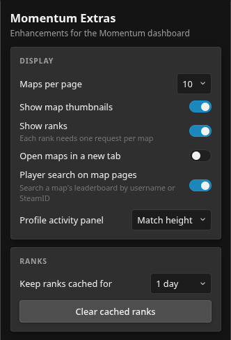
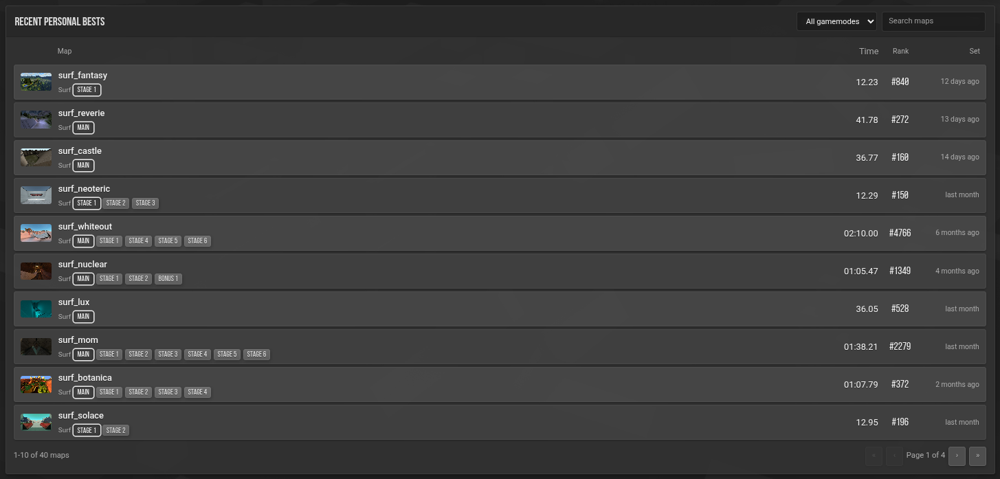
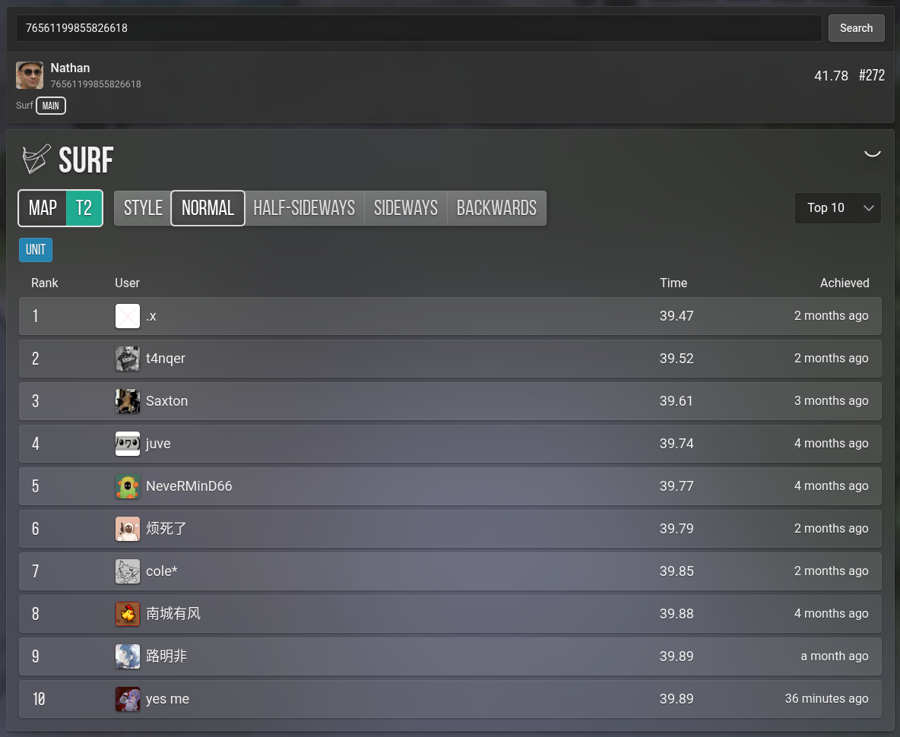
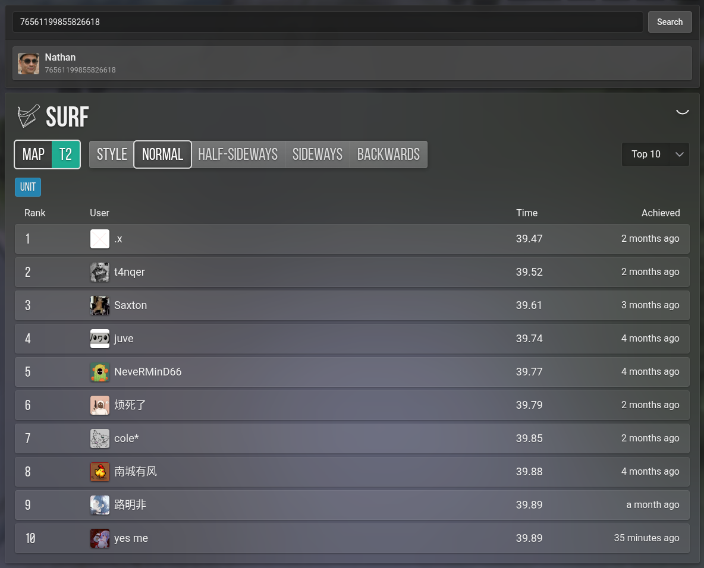

# Momentum Extras

Unofficial browser extension that adds enhancements to the
[Momentum Mod](https://momentum-mod.org/) dashboard.

> Not affiliated with or endorsed by Momentum Mod.

## Features

- **Recent personal bests** on profile pages, with rank badges, pagination,
  a gamemode filter, and map search.
- **Map credits** on profile pages, grouped by credit type.
- **Player search** on map pages, so you can look up any player's personal
  best on the map you're viewing.
- **Activity panel control** on profile pages: match the page height, keep the
  default, or hide it entirely.
- **Popup settings** for rows per page, thumbnails, rank badges, opening maps
  in a new tab, the map player search, rank cache duration, and clearing the
  rank cache.

## Screenshots

Options popup



Recent personal bests on a profile page



Player search on a map page



Player search result with rank



## Install

Download the latest zips from the [Releases](../../releases) page.

### Chrome, Chromium, Brave, Edge

1. Download and unzip `momentum-extras-<version>-chrome.zip`.
2. Open `chrome://extensions` and enable **Developer mode**.
3. Click **Load unpacked** and select the unzipped folder.

### Firefox

These builds are not signed by Mozilla, and Firefox only installs signed
add-ons permanently. You can still load the build temporarily:

1. Download `momentum-extras-<version>-firefox.zip` (do not unzip it).
2. Open `about:debugging#/runtime/this-firefox`.
3. Click **Load Temporary Add-on…** and select the zip.
4. It is removed when Firefox restarts.

For a permanent install, use Firefox Developer Edition or Nightly and disable
`xpinstall.signatures.required` in `about:config`.

## Development

Requires [Bun](https://bun.sh/) (or Node.js 20+) and a Chromium- or
Firefox-based browser.

```sh
bun install
bun run dev          # Chrome, with hot reload
bun run dev:firefox  # Firefox, with hot reload
bun run compile      # type-check only
```

Build production bundles and store-ready zips:

```sh
bun run build          # Chrome
bun run build:firefox  # Firefox
bun run zip            # Chrome zip
bun run zip:firefox    # Firefox zip (+ sources zip)
```

Everything is written to `.output/`.

## Permissions and privacy

- `storage`: saves your settings and the local rank cache.
- Network requests are made only to `api.momentum-mod.org` to read public
  profile, run, and map data.
- No analytics, telemetry, or data collection.

## Built with

[WXT](https://wxt.dev/) + [React](https://react.dev/), TypeScript.
